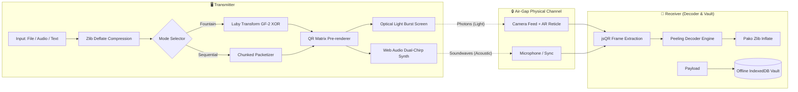

# QR_APP 🟦🟨🟥🟩

[](https://github.com/aryan0880)
[](./LICENSE)
[](https://github.com/aryan0880/QR_APP)
[](https://github.com/aryan0880/QR_APP)

> **Created and Engineered by [Aryan](https://github.com/aryan0880)**  
> *Transmit text, confidential notes, photos, and audio across air-gapped devices using only light bursts and acoustic chirps — zero internet, zero cloud servers, zero radio signals.*

---

## 🌟 Overview

**QRMesh** is a client-side optical and acoustic transmission suite designed to bridge data across physically separated, untrusted, or air-gapped devices without Wi-Fi, Bluetooth, NFC, or cellular connectivity.

By combining high-speed animated 2D matrix light pulses (QR frames), mathematical **Fountain Codes (Luby Transform)** over $\text{GF}(2)$, dual-channel acoustic frequency chirps, and an in-browser camera peeling decoder, QRMesh guarantees reliable peer-to-peer data reconstruction with **100% optical isolation**.

---

## 🎬 Live Demonstration

<div align="center">
  <video src="./Preview/Preview.mp4" autoplay loop muted playsinline width="100%"></video>
  <p><em>🎥 <b>Watch in Action:</b> Real-time optical beam transmission of a high-res photo, 8-bit audio chime, and encrypted secret note between laptop screen and mobile camera.</em></p>
</div>

---

## ⚡ Key Capabilities

### 1. 🖥️ Fullscreen "Across-the-Room" Theater Beam Mode
- Maximize the optical stream to occupy 100% of your monitor, TV, or tablet screen.
- High-contrast isolated white stage allows smartphones and webcams to scan and collect data from **10+ feet across an entire room**.
- Keyboard shortcuts (`Esc` to exit) and floating interactive controls.

### 2. 🗄️ Offline Encrypted Vault (Transmission History)
- Built-in browser-native `IndexedDB` storage archives all incoming transmissions offline.
- Inspect received items anytime: play back audio notes, copy decrypted text, or re-download binary files.
- Includes an instant **"💥 Nuke Vault"** security purge button for zero residual trace.

### 3. 🔊 Optical + Acoustic Dual-Channel (Sound Chirps Backup)
- Real-time Web Audio API dual-tone chiptune synthesizer generates high-frequency acoustic chirps in sync with optical light pulses.
- Provides tactile auditory pacing and multi-modal transmission redundancy.

### 4. 📝 Air-Gapped Text & Secret Note Mode
- Beam Bitcoin/crypto seed phrases, PGP keys, passwords, code snippets, or confidential notes between air-gapped computers and mobile devices.
- Includes one-click **"Paste from Clipboard"** on the sender and **"Copy Text"** with monospace terminal display on the receiver.
- Direct export as `.txt` files with zero server roundtrips.

### 5. ⛲ Fountain Codes Protocol (Luby Transform)
- Encodes files into rateless mathematical XOR combinations over $\text{GF}(2)$.
- **Zero Waiting for Missed Frames**: The receiver never stalls waiting for a missed block in a carousel; collecting *any* $K$ innovative droplets reconstructs the entire file immediately.
- Backwards-compatible with classic sequential carousel mode.

### 6. 🎯 AR Viewfinder Guides & HUD
- Real-time 2D tracking reticle overlay follows the QR code in the camera viewfinder with corner alignment nodes and visual lock state.
- Animated optical laser scan sweep line provides intuitive visual feedback during signal acquisition.

### 7. ⚡ Live Telemetry Speedometer
- Real-time dashboard showing instantaneous transfer rate (`KB/s`), scan framerate (`FPS`), and dynamic Estimated Time of Arrival (`ETA`).

### 8. 📱 PWA Offline Support (Installable Web App)
- Includes Web App Manifest and Service Worker caching.
- Add to Home Screen on iOS, Android, macOS, or Windows for **100% standalone offline operation in Airplane Mode**.

---

## 🏗️ Protocol Architecture



---

## 🚀 Getting Started

### Prerequisites

- [Node.js](https://nodejs.org/) (v18 or higher)
- Modern web browser with camera access (Chrome, Edge, Safari, Firefox)

### Installation

```bash
# Clone the repository
git clone https://github.com/aryan0880/QR_APP.git
cd QR_APP

# Install dependencies
npm install

# Start local development server with HTTPS
npm run dev
```

> **Why HTTPS is Enabled by Default:**  
> Modern mobile operating systems (iOS Safari, Android Chrome) strictly block camera APIs (`navigator.mediaDevices.getUserMedia`) over plain HTTP. QRMesh includes `@vitejs/plugin-basic-ssl` so you can open `https://<your-local-ip>:3000` on your mobile phone on your local hotspot or Wi-Fi and use the camera instantly.

---

## 📖 How To Use

### Step 1: Transmitting Data
1. Open QRMesh on your transmitting computer or phone and select **Transmit**.
2. Select your payload type:
   - **Photo / Audio**: Drag and drop an image, sound clip, or use the preloaded demo buttons.
   - **Text / Secret Note**: Type or paste confidential text, passwords, or seed phrases.
3. Choose your transmission engine:
   - **Fountain (Rateless)** *(Recommended)*: Rapid random packet spray with zero frame-wait penalties.
   - **Sequential**: Classic ordered packet loop.
4. Optional: Enable **Sound Chirps (`🔊`)** for acoustic pulses.
5. Tap **Maximize (`⛶`)** to enter **Across-the-Room Theater Mode** for scanning from 10+ feet away!

### Step 2: Receiving Data
1. Open QRMesh on the receiving device and select **Scan**.
2. Tap **Start Scanner** and grant camera permissions.
3. Aim the camera at the transmitting screen.
4. The **AR Viewfinder** will lock onto the QR matrix, while the **Speedometer HUD** monitors your bandwidth and ETA.
5. Once 100% of packets are collected, the payload instantly decodes, triggers haptic vibration feedback, and downloads or displays the decrypted text.

### Step 3: Inspecting the Offline Vault
1. Click **Vault** in the header.
2. Review past transmissions, copy text notes with one click, replay audio recordings, or export files.
3. Hit **Nuke Vault** to securely wipe all stored records from your device.

---

## 🛠️ Tech Stack

| Component | Technology |
|---|---|
| **Author & Creator** | **Aryan** |
| **Frontend Framework** | React 19, TypeScript, Vite 6 |
| **Styling & Theme** | Tailwind CSS v4, Tactile Lego Neobrutalism |
| **Animations** | Motion (Framer Motion), Lucide Icons |
| **Optical Engine** | `qrcode`, `jsqr` |
| **Acoustic Engine** | Web Audio API Dual-Tone Chiptune Synthesizer |
| **Mathematical Engine** | Custom Luby Transform / Fountain Code Peeling Decoder over $\text{GF}(2)$ |
| **Data Compression** | `pako` (Zlib/Deflate) |
| **Local Storage** | Browser IndexedDB |
| **PWA Engine** | Service Worker Cache-First Engine & Web App Manifest |

---

## 👤 Author

**Aryan**
- **GitHub**: [@aryan0880](https://github.com/aryan0880)
- **Email**: [aryansonawane094@gmail.com](mailto:aryansonawane094@gmail.com)
- **Project**: [QR_APP Repository](https://github.com/aryan0880/QR_APP)

---

## 📄 License

This project is licensed under the **MIT License** - see the [LICENSE](./LICENSE) file for details.  
Copyright © 2026 **Aryan**. All rights reserved.
